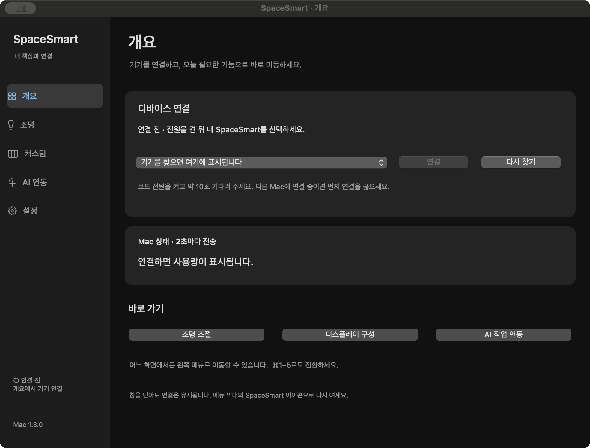

# SpaceSmart · 스페이스 똑똑

ESP32-S3 책상용 환경 디스플레이와 macOS 클라이언트입니다. 온도·습도·CO₂·조도·재실 상태를 표시하고, Bluetooth로 Mac 사용량과 AI 작업 상태를 전달합니다.

| 구성 | 버전 | 시작하기 |
|---|---|---|
| Arduino 펌웨어 | v2.3 · ESP32-S3 N16R8 | [설치·배선·디바이스 사용법](Arduino/README.md) |
| 케이스 설계 | RevU · Formwork + STL | [출력·조립 가이드](formwork/README.md) |
| macOS 앱 | v1.3.0 · macOS 13 이상 | [설치·연결·앱 사용법](macos/README.md) |

## 빠른 시작

### 이미 완성된 디바이스가 있다면

1. [최신 릴리스](https://github.com/kakao-workshop/spacesmart/releases/latest)에서 `SpaceSmart-Mac-1.3.0.dmg`를 받습니다.
2. DMG 안의 `SpaceSmart.app`을 **Applications(응용 프로그램)** 폴더로 드래그합니다.
3. 복사한 앱을 실행하고 Bluetooth 사용을 허용합니다.
4. 보드 전원을 켜고 약 10초 기다린 뒤 **개요 → 내 SpaceSmart 선택 → 연결**을 누릅니다.
5. 디바이스의 노브를 돌려 환경·컴퓨터·시계·커스텀 화면을 확인합니다.

앱 사용에는 Python·Homebrew·Xcode·Arduino 설치가 필요 없습니다. 조명 기능에는 펌웨어 v2.3 이상이 필요합니다.

### 처음 만드는 경우

1. [부품과 배선](Arduino/README.md#부품과-배선)을 확인합니다.
2. [RevU 케이스](formwork/README.md)를 출력하고 조립합니다. 작은 끼움 시험편부터 확인하세요.
3. [Arduino 설치 절차](Arduino/README.md#펌웨어-설치)에 따라 `Arduino/SpaceSmart/SpaceSmart.ino`를 업로드합니다.
4. 위의 Mac 설치 절차로 연결합니다.

## 기능

- 환경: 온도·습도·CO₂·조도, 재실 센서, 30분·6시간·24시간 그래프
- 디스플레이: ST7789 240×320 패널을 **가로 320×240**으로 사용, 블랙 테마 4종, 큰 시계, 집중 타이머
- Mac: CPU·메모리·네트워크 사용량과 시각 전송, 사용자 지정 카드 최대 3개
- AI: Claude Desktop의 **Code 탭**, Codex 작업 상태 연동과 표시 시험
- LED: AI 상태·CO₂ 표시, PC 연결 없이 디바이스 메뉴에서 연결 시험
- 조명: nRF24를 통한 **MJGJD01YL** 제어, 위치별 조정 전후 조도 기록, 사용자 선호 학습 후 선택적 자동 밝기 조절

조명 RF 제어와 현장 자동 조절은 아직 실물 검증 전입니다. 조명 제어·자동 조절은 기본으로 꺼져 있으며, 등록과 실제 동작 확인 후 사용합니다. [지원 범위와 검증 상태](docs/VERIFICATION.md)를 참고하세요.

## Mac에서 이동하기

| 메뉴 | 하는 일 |
|---|---|
| 개요 | 기기 연결·연결 취소, PC 사용량, 바로 가기 |
| 조명 | 직접 조절 / 자동 조절 / 연결 설정 |
| 커스텀 | 데이터 종류·제목·텍스트를 카드 3개에 배치하고 저장 |
| AI 연동 | Claude·Codex 연동 설치·해제, Codex 표시 시험 |
| 설정 | 로그인 시 자동 실행, 설치 가이드, 데이터 폴더 |

어느 화면에서도 왼쪽 메뉴로 이동합니다. `⌘1~5`는 메뉴 전환, `⌘,`는 설정입니다. 창을 닫아도 메뉴 막대에서 실행되며 `⌘Q`로 종료합니다.



## 저장소 구성

```text
Arduino/                 ESP32-S3 스케치, 센서·화면·조명 코드, 배선, 테스트
  SpaceSmart/            Arduino IDE에서 여는 메인 스케치
  SpaceSmartRadarTest/   LD2410C 개별 진단 스케치
  wiring/                신호·전원 CSV와 배선도
  docs/                  BLE 확장 규격과 조명 안내
formwork/
  RevU/                  편집 가능한 .formwork, STL 5개, Fit_Test 3개, 검증용 3MF
  tools/                 원본 모델에서 STL 재생성
macos/                   Swift/AppKit 소스와 빌드·패키징 도구
  legacy/                이전 개발용 브리지 소스와 테스트
  tests/                 현재 네이티브 앱의 검증 실행 도구
docs/                    설치 PDF, 검증 범위, 이미지
```

세 폴더는 같은 제품의 소스입니다. 빌드 도구와 공통 글꼴·문서를 함께 사용하므로 개발할 때는 저장소 전체를 받으세요.

```sh
git clone https://github.com/kakao-workshop/spacesmart.git
cd spacesmart
```

[상세 설치 PDF](docs/SpaceSmart-설치가이드.pdf) · [데이터 흐름과 개발 안내](docs/ARCHITECTURE.md) · [검증 범위](docs/VERIFICATION.md)

## 데이터와 라이선스

프롬프트·응답 본문·도구 인수·API 키는 수집하지 않습니다. Mac 앱은 선택한 디바이스로 PC 사용량·시각·AI 상태·프로젝트 폴더 이름을 전송합니다. 조명 학습 기록과 설정 백업은 사용자의 Mac에 저장됩니다. 공개 저장소에는 개인 설정, 훅 원본 백업, 실행 상태, 로그를 포함하지 않습니다.

프로젝트는 기존 [MIT 라이선스](LICENSE)를 따릅니다. Nanum Gothic은 [SIL OFL](Arduino/resources/fonts/LICENSE.txt), 조명 프로토콜 구현 참고 코드는 [별도 MIT 고지](Arduino/docs/LIGHTBAR_THIRD_PARTY.txt)를 따릅니다. Arduino 의존 라이브러리는 각 프로젝트의 라이선스를 따르며 이 저장소에 번들하지 않습니다.
