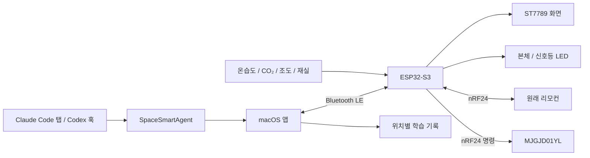

# 구성과 데이터 흐름

[전체 안내](../README.md)



조명은 상태나 명령 ACK를 회신하지 않습니다. 표시 상태는 송신 명령과 원래 리모컨 수신 기록으로 추정합니다. BLE 접수 확인은 ESP32의 명령 접수 여부입니다.

## 소스 진입점

| 위치 | 책임 |
|---|---|
| `Arduino/SpaceSmart/SpaceSmart.ino` | Arduino setup/loop 진입점 |
| `SpaceSmartApp.cpp`, `Config.h` | 주변장치 초기화, 센서, 핀과 보드 설정 |
| `DashboardModel.h`, `DashboardController.h`, `DashboardRenderer.cpp` | 화면 상태, 입력 처리, 픽셀 렌더링 |
| `DashboardLink.*` | BLE 수신, PC·AI·커스텀·조명 확장 |
| `LightbarModel.h`, `LightbarService.*` | 무선 패킷, 추정 상태, 조절 전후 이벤트, 전송 제어 |
| `macos/AppMain.swift`, `WorkspaceUI.swift` | 단일 창과 고정 사이드 메뉴 |
| `macos/CustomWindow.swift`, `LightWindow.swift` | 메인 창 안에 삽입되는 커스텀·조명 패널 |
| `macos/BluetoothBridge.swift`, `Telemetry.swift` | BLE 연결, PC 사용량, 시계, 전송 대기열 |
| `macos/AgentStore.swift`, `AgentMain.swift`, `HookInstaller.swift` | AI 상태 수집·만료, 보조 실행 파일, 훅 설치·해제 |
| `macos/LightLearning.swift`, `LightController.swift` | 위치별 저장, 학습 준비 판정, 자동 조절 |
| `formwork/RevU/SpaceSmart_RevU.formwork` | 편집 가능한 최신 케이스 원본 |

펌웨어 파일 이름의 상대 위치는 `Arduino/SpaceSmart/`를 기준으로 합니다. 공개용 정리 과정에서는 런타임 제어 로직을 바꾸지 않고 경로와 빌드·패키징 도구를 조정했습니다.

## BLE 확장

- [커스텀 데이터 형식](../Arduino/docs/CUSTOM_PROTOCOL.txt)
- [조명 명령·상태·이벤트 형식](../Arduino/docs/LIGHTBAR_PROTOCOL.txt)

Mac은 PC·시각·AI·커스텀 값을 전송하고 조명 상태·학습 이벤트를 수신합니다. 자동 조절은 기본 꺼짐이며 학습 자료의 품질, 사용자의 실물 확인, 재실·신선한 센서값, 수동 조작 대기 시간 등을 통과해야 합니다.

## 재현용 명령

저장소 루트에서 실행합니다.

```sh
sh Arduino/tests/run.sh
sh macos/tests/run.sh           # macOS / Xcode Command Line Tools 필요
zsh macos/build.sh              # macOS 앱 universal 빌드
python3 formwork/tools/export_stl.py   # NumPy 필요
python3 macos/package_release.py      # 앱 빌드 후 DMG/소스 ZIP 생성
```

프리뷰 이미지 생성에만 Pillow를 추가로 사용합니다.

```sh
python3 Arduino/tools/prepare_dashboard_previews.py build/dashboard
```

글꼴·문서·STL 재생성 도구를 제외한 일반 사용자용 Mac 앱에는 외부 런타임 의존성이 없습니다. 단위 테스트는 사용자 설정이나 디바이스를 변경하지 않습니다. 테스트 러너와 빌드 명령은 보드에 펌웨어를 업로드하지 않습니다.

## 배포 파일 관리

소스는 `Arduino/`, `formwork/`, `macos/`와 문서에 모읍니다. 앱·DMG·ZIP은 `build/`, `dist/`에서 생성하고 GitHub Releases로 배포합니다. 임시 빌드, 이전 설계 실험본, 사용자 상태·설정·백업은 추적 대상이 아닙니다.

기존 작업 공간의 경로를 사용하는 예전 배포본과 달리, 이 저장소에서는 Arduino 스케치가 `Arduino/SpaceSmart/`, 앱 빌드 도구가 `macos/build.sh`에 있습니다.
