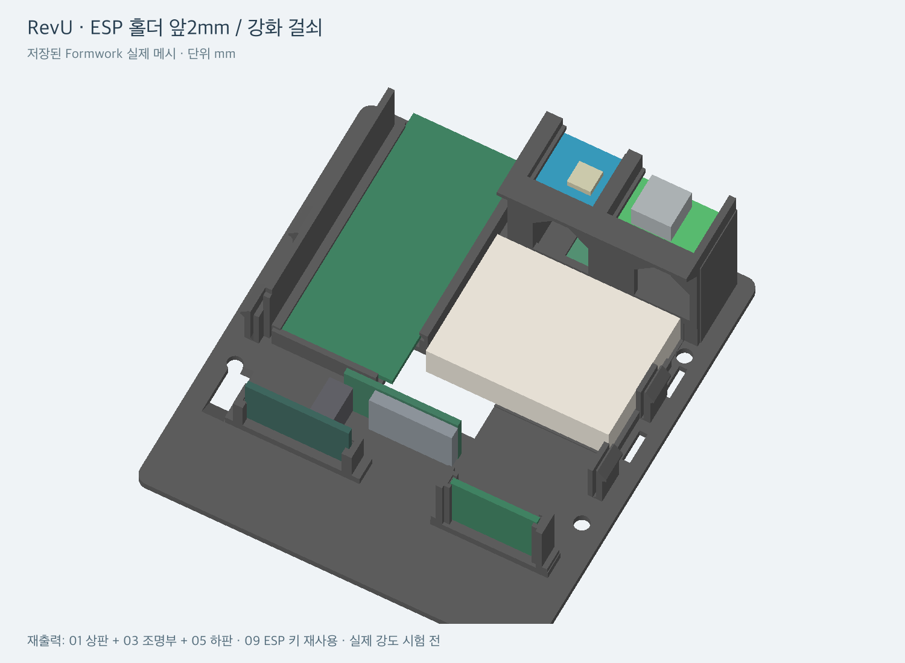

# SpaceSmart 케이스 · Formwork + STL

[전체 안내로 돌아가기](../README.md)

현재 제작 기준은 **RevU(2026-10-31)**입니다. 편집 가능한 모델, 출력 방향이 적용된 STL, 작은 끼움 시험편과 조립 안내를 함께 제공합니다. 단위는 **mm**입니다.

## 받을 파일

- [SpaceSmart_RevU.formwork](RevU/SpaceSmart_RevU.formwork): Formwork에서 열어 편집하는 원본 모델
- [STL 폴더](RevU/STL): 본체 출력 부품 5개
- [Fit_Test 폴더](RevU/Fit_Test): 걸쇠 공차 확인용 시험편 3개
- [Bambu Studio 검증용 3MF](RevU/RevU_A1_0p12_support_off_checked.3mf)
- [상세 사용안내](RevU/사용안내.txt), [부품·방향·해시 목록](RevU/print-parts.json)

GitHub 파일 화면에서 Download raw로 받거나, [저장소 ZIP](https://github.com/kakao-workshop/spacesmart/archive/refs/heads/main.zip)을 내려받으세요.



## 출력할 부품

| 파일 | 부품 | 색상 | 비고 |
|---|---|---|---|
| `01_main_body_black.stl` | 상판 | 검정 | RevU로 출력 |
| `02_original_front_optional_black.stl` | 원본 LCD 전면 | 검정 | 기존 부품 재사용 가능 |
| `03_integrated_lower_base_white.stl` | 일체형 조명부 | 흰색 | RevU로 출력 |
| `05_integrated_slot_tray_black.stl` | 하판·부품 트레이 | 검정 | RevU로 출력 |
| `09_esp_retainer_black.stl` | ESP32 고정 키 | 검정 | 기존 부품 재사용 가능 |

01·03·05는 RevU 세트로 사용하세요. STL은 출력 방향으로 정렬되어 있고 바닥이 Z=0에 놓입니다. 01은 후면을 베드에, 03·05는 바닥을 베드에 놓는 방향입니다. 분리된 이전 부품을 추가 출력할 필요 없이 03이 일체형 조명부 역할을 합니다.

## 출력 순서

1. 실제 사용할 소재로 **Fit_Test의 작은 3부품**을 먼저 출력합니다.
2. 걸쇠를 끼우고 해제하면서 공차를 확인합니다. 실제 조립 강도·반복 수명은 출력 시험 전입니다.
3. 본체 STL을 슬라이서에 가져와 03은 흰색, 01·05는 검정으로 나눠 출력합니다.
4. 02·09가 이미 있으면 재사용하고 없으면 함께 출력합니다.

기존 슬라이싱 확인 조건은 **Bambu Lab A1 / 0.4 mm 노즐 / 0.12 mm Fine / 첫 레이어 0.2 mm / 서포트 끔**입니다. 번들 3MF는 **단색 기하 검증용 배치**이므로 실제 검정·흰색 생산 배치와 구분하세요. 다른 프린터·소재에서는 본인의 설정으로 다시 슬라이싱합니다. 기존 예상치는 09 포함 약 6시간, 125.73 g이며 실제 시간·재료 사용량은 설정에 따라 달라집니다.

## 조립과 분리

1. [배선 안내](../Arduino/README.md#부품과-배선)를 보고 하판에 DC 보드·센서·ESP32와 배선을 배치합니다.
2. DC 보드는 조명부 결합 전에 후면에서 앞쪽으로 밀어 넣습니다. USB 아래 탄성 턱을 눌러 통과시키고 V/G 선은 앞쪽 통로로 뺍니다.
3. 조명부 정렬핀과 하부 걸쇠 4개를 맞춰 하판에 결합합니다.
4. 상판을 내려 상부 걸쇠 4개를 결합합니다.
5. 상판 분리는 측면 8.4×1.65 mm 창에서 얇고 평평한 도구로 걸쇠를 안쪽으로 누르며 한 모서리씩 해제합니다.
6. 조명부 분리는 상판 제거 후 하판 위에서 하부 걸쇠를 안쪽으로 눌러 해제합니다.

케이블을 당겨 분리하거나 걸쇠 몸통을 비틀지 마세요. 상세 삽입 방향과 변경 치수는 [사용안내](RevU/사용안내.txt), [설계 치수](RevU/revision-spec.json), [접합부 그림](RevU/joint-sections.png)에 있습니다. LED 접착 경로는 134 mm, 전면·좌우 발광벽은 0.8 mm 기준입니다.

## Formwork에서 수정

`.formwork` 파일은 원본 메시와 조립 관계를 포함합니다. Formwork에서 파일을 열어 수정하고 새 리비전 이름으로 저장합니다. 참고 부품과 조립용 좌표는 출력용 STL의 방향과 다를 수 있으므로 출력 부품과 방향을 확인하세요.

Python + NumPy를 사용할 수 있다면 저장된 원본에서 출력 부품을 다시 추출할 수 있습니다. 저장소 루트에서 실행합니다.

```sh
python3 -m venv .venv
.venv/bin/python -m pip install numpy
.venv/bin/python formwork/tools/export_stl.py
```

결과는 `build/formwork/RevU/`에 저장됩니다. 원본 모델의 메시와 `print-parts.json`의 객체 ID·출력 회전값을 사용하며, 저장소의 기존 STL을 덮어쓰지 않습니다. 모델의 객체 ID를 바꾸면 부품 목록도 함께 갱신하세요.

## 검증 상태

저장된 보고서 기준으로 본체 5부품·시험편 3개의 열린 경계·비다양체 모서리·퇴화면은 0입니다. 강체 삽입 간섭과 슬라이싱을 확인했습니다. DC 탄성 턱은 의도적으로 눌리는 부품으로 강체 간섭과 구분합니다.

**실물 출력 후 유지력, 반복 조립 수명, 센서 광학 영향은 아직 측정 전**입니다. 슬라이싱 성공이 실물 끼움 품질을 보증하지는 않습니다. [검증 보고서](RevU/validation-report.json)를 함께 참고하세요.
